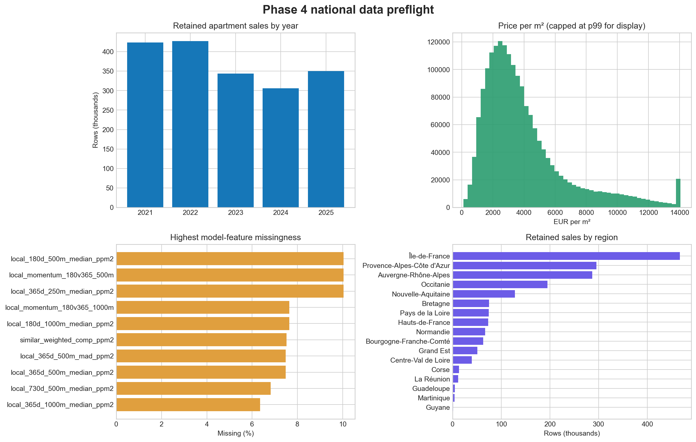
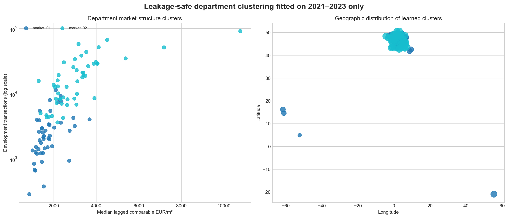

# Phase 4 national preflight and market clustering

**Execution status: empirical preflight complete; final model benchmark remains separate.**

This audit describes the model-ready national cohort before CatBoost training. It checks temporal and
territorial coverage, missingness, distribution shape, historical-comparable availability, and a
development-only clustering experiment. No 2024 or 2025 transaction value is used to fit the clusters.

## Dataset overview

| Year | Retained apartment sales |
|---:|---:|
| 2021 | 423,325 |
| 2022 | 427,567 |
| 2023 | 343,586 |
| 2024 | 305,609 |
| 2025 | 350,399 |

- Period: **2021-01-01 to 2025-12-31**
- Total rows: **1,850,486**
- Represented departments: **97**
- Represented regions: **17**
- Median transaction value: **EUR 164,000**
- Median price per m²: **EUR 3,261**
- Lagged weighted-comparable coverage: **94.00%**

## Preprocessing decision

CatBoost inputs are not standardized. Tree splits do not require a common numeric scale, categorical
territorial identifiers must remain strings, and the target is already fitted as `log1p(value)`. Numeric
standardization is used only inside K-means after median imputation of department-level profiles.
`surface_terrain` is retained in the audited Gold table but excluded from the fitted contract after the
preflight found **99.44% missingness** for
apartment sales. Missing historical-comparable values remain meaningful and are accompanied by explicit
coverage and count features, so CatBoost handles them natively.

## Leakage-safe clustering

Departments are summarized using 2021–2023 transaction volume, apartment structure, and comparable-sale
features that already enforce the 90-day availability lag. The current transaction target is excluded.
The number of clusters is selected by silhouette score.

| Clusters | Silhouette score |
|---:|---:|
| 2 | 0.3172 |
| 3 | 0.2576 |
| 4 | 0.2383 |
| 5 | 0.2332 |
| 6 | 0.2288 |
| 7 | 0.2451 |
| 8 | 0.2532 |

Selected: **2 clusters**.

| Cluster | Departments | Development rows | Median lagged EUR/m² | Median comparable coverage |
|---|---:|---:|---:|---:|
| market_01 | 47 | 139,814 | 1,528 | 89.0% |
| market_02 | 50 | 1,054,664 | 2,942 | 91.0% |

## Interpretation and next decision

Clusters are descriptive market-structure groups learned from development-period features. They are not administrative boundaries, causal market definitions, or evidence of predictive improvement until the 2024 ablation is evaluated. The benchmark compares otherwise identical CatBoost candidates with and
without the cluster feature on 2024. Only that chronological ablation can justify retaining clustering
for the frozen 2025 test and production bundle.
