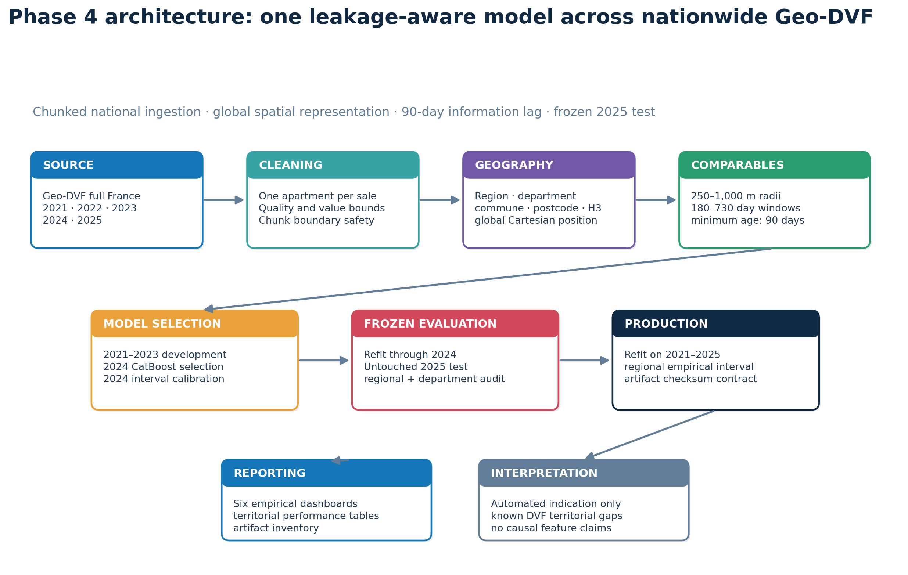

# Phase 4 — Nationwide France apartment valuation

Generated at 2026-08-26T17:43:33.656036+00:00.

**Execution status: methodology report; empirical results pending.**

## Executive summary

The national acquisition, feature build, and benchmark have not yet been executed in this
workspace. Consequently, this report contains **no claimed Phase 4 accuracy figures**. It documents the
complete protocol and renders the architecture now; empirical sections and six additional dashboards are
populated automatically by rerunning the reporting command after the national pipeline completes.

Phase 4 transfers the chronological, leakage-aware research protocol from Paris to a single national
CatBoost model. It does **not** transfer Paris-only transport, school, park, noise, BAN/BDNB, or DPE
fields where a nationally consistent snapshot has not been established. This choice makes the national
comparison narrower but auditable.

## Scope and territorial coverage

Territorial row counts and comparable coverage will be inserted from `feature_quality.json`.

Geo-DVF does not publish open observations for Moselle (57), Bas-Rhin (67), Haut-Rhin (68), or Mayotte
(976). The phrase “nationwide” therefore means every department represented by the upstream Geo-DVF
source, not universal coverage of all French territory. Corsica and represented overseas departments are
handled explicitly through alphanumeric/three-digit department codes and spherical geometry.

## Research questions

1. Can one model learn heterogeneous apartment markets across French regions without collapsing local
   price structure into a national average?
2. Do region, department, commune, postcode, H3 and continuous global-location features provide enough
   spatial hierarchy for previously unseen annual transactions?
3. Do strictly lagged local comparable sales improve on a training-only geographic median baseline?
4. How uneven are error, calibration and comparable coverage across regions and departments?
5. Does the empirical uncertainty interval retain useful coverage under the 2024→2025 time shift?

## Data source and cohort construction

The input is the normalized, geolocated Geo-DVF annual `full.csv.gz` archive for each year from 2021
through 2025. Files are streamed in bounded chunks. A carry-over buffer prevents a mutation split at a
chunk boundary from being classified before all its property rows are available.

The cohort keeps `Vente` mutations containing exactly one apartment (`code_type_local = 2`) and no house
or commercial property. Dependencies such as parking or cellars may remain bundled because DVF reports
mutation-level consideration. Required values are transaction date, value, surface, commune and valid
WGS84 coordinates. Fixed admissibility bounds are 9–300 m², EUR 10,000–10,000,000, and EUR
100–30,000/m². These broad national bounds remove obvious corruption while retaining lower-price markets.

## Feature contract

| Family | Count | Purpose |
|---|---:|---:|
| Property | 7 | Surface, rooms, address number, lots, terrain, log surface, room density |
| Calendar | 4 | Month, day of year, year, months since January 2021 |
| Global location | 5 | Latitude, longitude and unit-sphere Cartesian x/y/z |
| Territorial identity | 7 | Region, department, commune, postcode and H3 r7/r8/r9 |
| Historical comparables | 23 | Lagged counts, medians, dispersion, similarity, distance, age and momentum |

The current transaction's `valeur_fonciere` and derived `price_per_m2` are explicitly excluded from model
inputs. `price_per_m2` may only contribute through older eligible transactions when comparable features
are computed.

### Global geography

Lambert-93 is not valid for all overseas departments. Phase 4 therefore represents position using WGS84,
H3 cells and unit-sphere Cartesian coordinates. Nearby-sale distances use BallTree haversine distance and
are processed independently per department. This prevents mainland-only projection assumptions and avoids
cross-border neighbor contamination.

### Historical comparable sales

For every target sale, a source transaction must be at least 90 days older and no more than 730 days old.
The feature builder evaluates 250 m, 500 m and 1,000 m radii over 180, 365 and 730-day windows. It records
counts, median EUR/m², local median absolute deviation, exponentially weighted EUR/m², effective sample
size, nearest distance, median age, similar-apartment evidence and short-versus-long momentum. No current
or future transaction can enter its own features.

## Model and chronological protocol

- **Development:** 2021–2023.
- **Selection/calibration:** two predeclared CatBoost configurations evaluated on 2024.
- **Frozen test:** the selected configuration is refitted through 2024 and evaluated once on 2025.
- **Production artifact:** after reporting test performance, the chosen model is refitted on 2021–2025.
- **Target:** `log1p(valeur_fonciere)`, transformed back to non-negative euros.
- **Baseline:** postcode median EUR/m² from prior training years, falling back to commune, department,
  region and finally national median.

CatBoost is retained from Phase 3 because it handles nonlinear numeric effects, missing values and nested
high-cardinality territorial categories without one-hot expansion. Configuration selection uses 2024 only;
regional and department tables are diagnostics, not additional tuning targets.

### 2024 candidate benchmark

_Pending `validation_trials.csv` from model selection._

### Frozen 2025 model-versus-baseline benchmark

_Pending `benchmark_comparison.csv` from the frozen test._

The benchmark is paired: both methods predict the identical test transactions. Phase 4 therefore reports
the transaction-level difference between baseline and model absolute error, together with a deterministic
paired bootstrap 95% interval. Bootstrap computation is capped at 250,000 test rows to bound memory; the
sample size and repetition count are recorded in `benchmark.json`.

## Evaluation framework

The national report records MAE, RMSE, R², MAPE, median absolute percentage error and hit rates within
±10% and ±20%. The same metrics are calculated for every region and for departments with at least 100
test observations. A 90% empirical interval is calibrated from 2024 target/prediction ratios, with regional
ratios used when at least 500 calibration observations exist and the national ratio used otherwise.

## Regional frozen-test results

_Pending `region_performance.csv` from the frozen test._

Regional comparisons must not be read as rankings of model quality alone. Sale-value mix, apartment
surface, urban density, sample size, geocoding completeness and comparable availability all alter raw MAE.
MdAPE and hit rates provide necessary scale-adjusted context.

## Visual diagnostics



The coverage map is a sampled point cloud rather than a political boundary map. It demonstrates the
transaction footprint without introducing an unversioned shapefile. Feature importance measures how often
and how strongly CatBoost uses a predictor; it is not a causal estimate of an amenity or location premium.

## Reproducibility and artifact integrity

| Artifact | Status | Size | SHA-256 |
|---|---|---:|---|
| `gold` | **not generated** | — | — |
| `feature_quality` | **not generated** | — | — |
| `benchmark` | **not generated** | — | — |
| `test_predictions` | **not generated** | — | — |
| `region_performance` | **not generated** | — | — |
| `department_performance` | **not generated** | — | — |
| `feature_importance` | **not generated** | — | — |
| `benchmark_comparison` | **not generated** | — | — |
| `validation_trials` | **not generated** | — | — |
| `source_manifest` | **not generated** | — | — |
| `production_model` | **not generated** | — | — |

Missing empirical artifacts in this rendering: `gold`, `feature_quality`, `benchmark`, `test_predictions`, `region_performance`, `department_performance`, `feature_importance`, `benchmark_comparison`, `validation_trials`, `source_manifest`, `production_model`.

Every downloaded archive, Gold table and benchmark input is hashed with SHA-256. Gold Parquet, JSON, CSV,
model and prediction files are written through sibling `.part` files and promoted only after successful
serialization. The production bundle records the exact feature-table checksum and feature lists.

## Limitations and responsible use

- DVF omits property condition, renovation quality, apartment floor, elevator, view, occupancy and many
  transaction-specific rights or bundled movable elements.
- Departments 57, 67, 68 and 976 are absent upstream; the model must reject unsupported inference there.
- Sparse rural and overseas markets can have few nearby comparable sales and wider error dispersion.
- H3 and administrative identifiers encode location but do not explain causal neighborhood effects.
- The 2025 holdout measures one annual temporal transfer. It does not guarantee 2026+ performance.
- Empirical prediction intervals are marginal coverage diagnostics, not certified conditional guarantees.
- Output is an automated statistical indication, not a notarial valuation, certified appraisal, lending
  decision, tax assessment or investment recommendation.

## Reproduction

```powershell
$env:PYTHONPATH = '.\src'
python -m paris_avm.data.acquire_phase4
python -m paris_avm.features.phase4
python -m paris_avm.modeling.benchmark_phase4
python -m paris_avm.visualization.phase4
```

The complete workflow is also available through:

```powershell
powershell -ExecutionPolicy Bypass -File .\scripts\run_phase4.ps1
```

For a methodology-only rendering before the large empirical run:

```powershell
python -m paris_avm.visualization.phase4 --allow-incomplete
```
