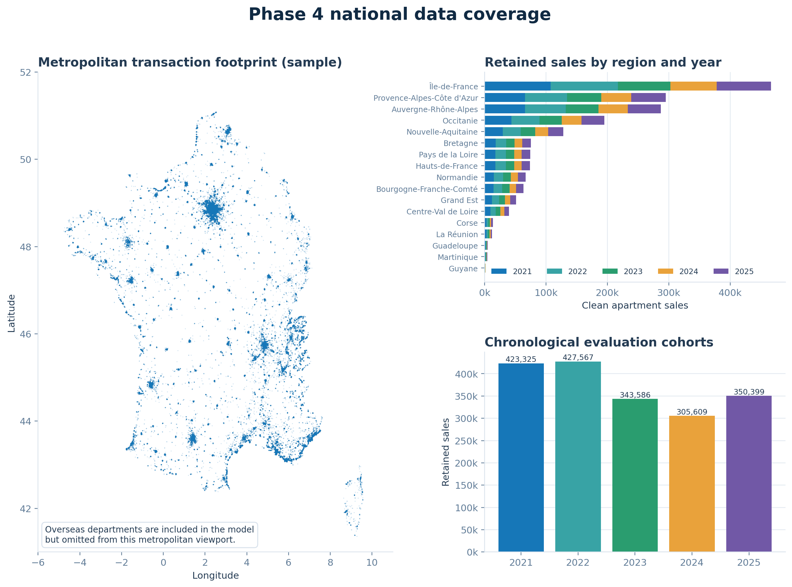
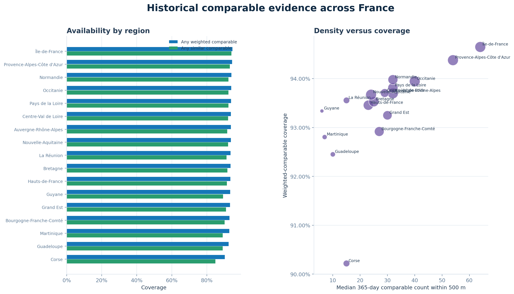
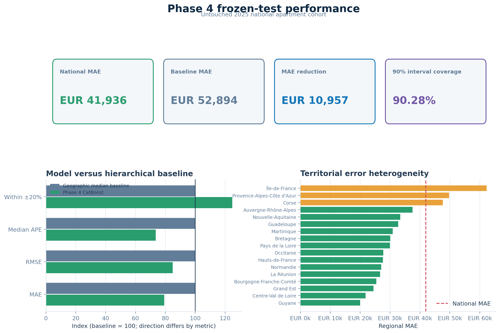
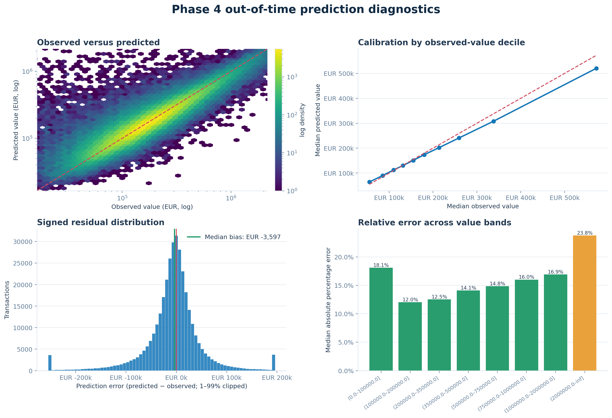
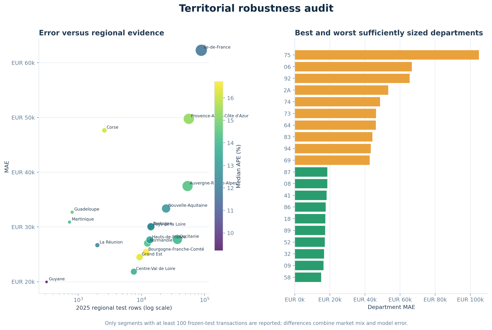
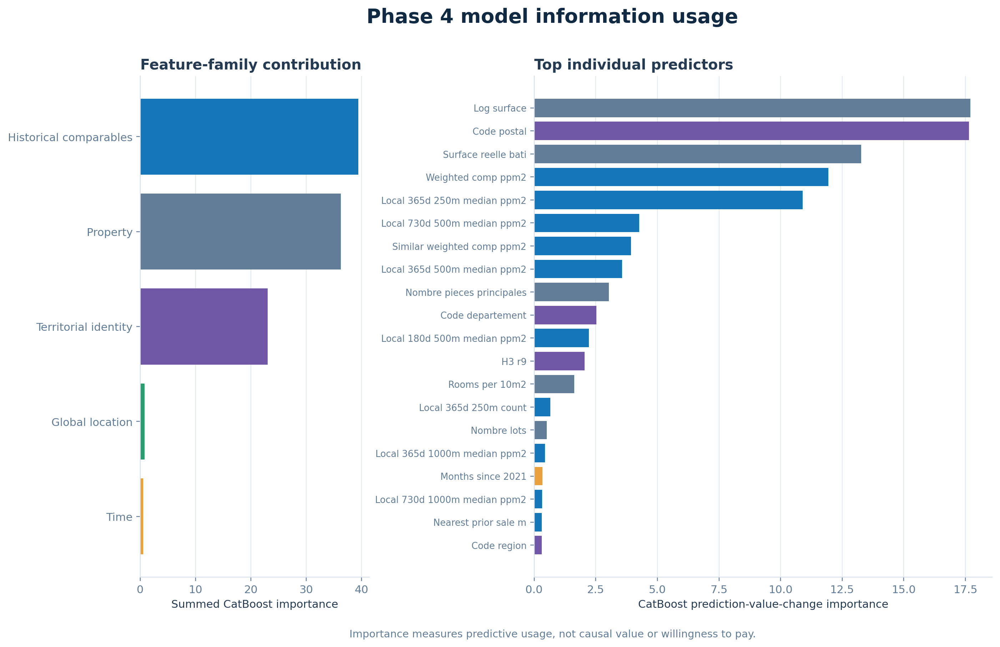

# Phase 4 — Nationwide France apartment valuation

Generated at 2026-08-27T18:22:16.193958+00:00.

**Execution status: complete empirical report.**

## Executive summary

The frozen 2025 test contains **350,399** apartment sales. The selected
CatBoost model reaches **EUR 41,936 MAE**, **13.50%
median absolute percentage error**, **66.97% within ±20%**, and **R² =
0.8490**. Against the training-only hierarchical geographic median baseline (EUR
52,894 MAE), the reduction is **EUR
10,957**. The empirical 90% interval covers
**90.28%** of test transactions.

Phase 4 transfers the chronological, leakage-aware research protocol from Paris to a single national
CatBoost model. It does **not** transfer Paris-only transport, school, park, noise, BAN/BDNB, or DPE
fields where a nationally consistent snapshot has not been established. This choice makes the national
comparison narrower but auditable.

## Scope and territorial coverage

The Gold table contains **1,850,486** retained sales from **2021-01-01** through **2025-12-31**, spanning **97 departments** and **17 regions** represented upstream.

Geo-DVF does not publish open observations for Moselle (57), Bas-Rhin (67), Haut-Rhin (68), or Mayotte
(976). The phrase “nationwide” therefore means every department represented by the upstream Geo-DVF
source, not universal coverage of all French territory. Corsica and represented overseas departments are
handled explicitly through alphanumeric/three-digit department codes and spherical geometry.

## Research questions

1. Can one model learn heterogeneous apartment markets across French regions without collapsing local
   price structure into a national average?
2. Do region, department, commune, postcode, H3 and continuous global-location features provide enough
   spatial hierarchy for previously unseen annual transactions?
3. Do strictly lagged local comparable sales improve on a training-only geographic median baseline?
4. How uneven are error, calibration and comparable coverage across regions and departments?
5. Does the empirical uncertainty interval retain useful coverage under the 2024→2025 time shift?

## Data source and cohort construction

The input is the normalized, geolocated Geo-DVF annual `full.csv.gz` archive for each year from 2021
through 2025. Files are streamed in bounded chunks. A carry-over buffer prevents a mutation split at a
chunk boundary from being classified before all its property rows are available.

The cohort keeps `Vente` mutations containing exactly one apartment (`code_type_local = 2`) and no house
or commercial property. Dependencies such as parking or cellars may remain bundled because DVF reports
mutation-level consideration. Required values are transaction date, value, surface, commune and valid
WGS84 coordinates. Fixed admissibility bounds are 9–300 m², EUR 10,000–10,000,000, and EUR
100–30,000/m². These broad national bounds remove obvious corruption while retaining lower-price markets.

## Feature contract

| Family | Count | Purpose |
|---|---:|---:|
| Property | 6 | Surface, rooms, address number, lots, log surface and room density |
| Calendar | 4 | Month, day of year, year, months since January 2021 |
| Global location | 5 | Latitude, longitude and unit-sphere Cartesian x/y/z |
| Territorial identity | 7 | Region, department, commune, postcode and H3 r7/r8/r9 |
| Historical comparables | 23 | Lagged counts, medians, dispersion, similarity, distance, age and momentum |

The current transaction's `valeur_fonciere` and derived `price_per_m2` are explicitly excluded from model
inputs. `price_per_m2` may only contribute through older eligible transactions when comparable features
are computed.

### Global geography

Lambert-93 is not valid for all overseas departments. Phase 4 therefore represents position using WGS84,
H3 cells and unit-sphere Cartesian coordinates. Nearby-sale distances use BallTree haversine distance and
are processed independently per department. This prevents mainland-only projection assumptions and avoids
cross-border neighbor contamination.

### Historical comparable sales

For every target sale, a source transaction must be at least 90 days older and no more than 730 days old.
The feature builder evaluates 250 m, 500 m and 1,000 m radii over 180, 365 and 730-day windows. It records
counts, median EUR/m², local median absolute deviation, exponentially weighted EUR/m², effective sample
size, nearest distance, median age, similar-apartment evidence and short-versus-long momentum. No current
or future transaction can enter its own features.

## Model and chronological protocol

### Pre-training audit and market clustering

The empirical audit covers **1,850,486 transactions** across
**97 departments** and **17 regions**. Weighted lagged-comparable
coverage is **94.00%**. K-means is fitted only on 2021--2023
department profiles; the current transaction target is excluded. Silhouette selection retains
**2 clusters**. Median imputation and standardization apply only within
K-means, not to CatBoost inputs.

The best clustered candidate reaches **EUR 42,161 MAE** versus **EUR 42,147** without clustering (difference **EUR 14**), so the cluster feature is **not retained**.
See [the detailed preflight report](PHASE4_PREFLIGHT_REPORT.md).

- **Development:** 2021–2023.
- **Selection/calibration:** two CatBoost configurations, each evaluated with and without clustering on 2024.
- **Frozen test:** the selected configuration is refitted through 2024 and evaluated once on 2025.
- **Production artifact:** after reporting test performance, the chosen model is refitted on 2021–2025.
- **Target:** `log1p(valeur_fonciere)`, transformed back to non-negative euros.
- **Baseline:** postcode median EUR/m² from prior training years, falling back to commune, department,
  region and finally national median.

CatBoost is retained from Phase 3 because it handles nonlinear numeric effects, missing values and nested
high-cardinality territorial categories without one-hot expansion. Configuration selection uses 2024 only;
regional and department tables are diagnostics, not additional tuning targets.

### 2024 candidate benchmark

| Candidate | Configuration | Cluster | Clipped | 2024 MAE | 2024 MdAPE | Within ±20% | R² |
|---|---:|---:|---:|---:|---:|---:|---:|
| 1 | {"depth": 8, "l2_leaf_reg": 8.0, "loss_function": "MAE"} | False | 0 | EUR 42,147 | 13.75% | 65.55% | 0.8390 |
| 3 | {"depth": 8, "l2_leaf_reg": 8.0, "loss_function": "MAE"} | True | 0 | EUR 42,161 | 13.74% | 65.57% | 0.8389 |
| 4 | {"depth": 9, "l2_leaf_reg": 10.0, "loss_function": "Huber:delta=1.0"} | True | 111119 | EUR 1,544,040 | 56.52% | 22.83% | -253.1405 |
| 2 | {"depth": 9, "l2_leaf_reg": 10.0, "loss_function": "Huber:delta=1.0"} | False | 201487 | EUR 6,031,220 | 3289.83% | 14.88% | -1062.6883 |

### Frozen 2025 model-versus-baseline benchmark

| Method | MAE | RMSE | MdAPE | Within ±20% | R² |
|---|---:|---:|---:|---:|---:|
| Phase 4 CatBoost | EUR 41,936 | EUR 92,375 | 13.50% | 66.97% | 0.8490 |
| Hierarchical geographic median baseline | EUR 52,894 | EUR 108,830 | 18.37% | 53.65% | 0.7905 |

The benchmark is paired: both methods predict the identical test transactions. Phase 4 therefore reports
the transaction-level difference between baseline and model absolute error, together with a deterministic
paired bootstrap 95% interval. Bootstrap computation is capped at 250,000 test rows to bound memory; the
sample size and repetition count are recorded in `benchmark.json`.

## Evaluation framework

The national report records MAE, RMSE, R², MAPE, median absolute percentage error and hit rates within
±10% and ±20%. The same metrics are calculated for every region and for departments with at least 100
test observations. A 90% empirical interval is calibrated from 2024 target/prediction ratios, with regional
ratios used when at least 500 calibration observations exist and the national ratio used otherwise.

## Regional frozen-test results

| Region | Rows | MAE | MdAPE | Within ±20% | R² |
|---|---:|---:|---:|---:|---:|
| Guyane | 315 | EUR 19,966 | 9.22% | 80.63% | 0.4994 |
| Centre-Val de Loire | 7,583 | EUR 21,840 | 13.68% | 66.58% | 0.7694 |
| Grand Est | 9,357 | EUR 24,482 | 16.37% | 58.56% | 0.7401 |
| Bourgogne-Franche-Comté | 11,843 | EUR 25,396 | 16.72% | 58.13% | 0.7188 |
| La Réunion | 2,006 | EUR 26,674 | 12.34% | 69.49% | 0.8030 |
| Normandie | 12,495 | EUR 27,043 | 14.22% | 64.66% | 0.7758 |
| Hauts-de-France | 13,583 | EUR 27,640 | 13.38% | 67.53% | 0.7954 |
| Occitanie | 37,205 | EUR 27,735 | 13.91% | 65.27% | 0.7473 |
| Pays de la Loire | 14,165 | EUR 29,952 | 12.79% | 69.22% | 0.7783 |
| Bretagne | 14,159 | EUR 30,070 | 12.64% | 70.00% | 0.7033 |
| Martinique | 727 | EUR 30,893 | 14.17% | 64.24% | 0.6421 |
| Guadeloupe | 801 | EUR 32,700 | 14.75% | 62.92% | 0.7218 |
| Nouvelle-Aquitaine | 24,590 | EUR 33,378 | 12.85% | 68.41% | 0.7878 |
| Auvergne-Rhône-Alpes | 53,825 | EUR 37,479 | 14.36% | 64.55% | 0.8171 |
| Corse | 2,596 | EUR 47,649 | 16.12% | 59.05% | 0.6277 |
| Provence-Alpes-Côte d'Azur | 56,352 | EUR 49,751 | 15.34% | 61.36% | 0.7395 |
| Île-de-France | 88,797 | EUR 62,277 | 11.71% | 73.98% | 0.8533 |

Regional comparisons must not be read as rankings of model quality alone. Sale-value mix, apartment
surface, urban density, sample size, geocoding completeness and comparable availability all alter raw MAE.
MdAPE and hit rates provide necessary scale-adjusted context.

## Visual diagnostics









The coverage map is a sampled point cloud rather than a political boundary map. It demonstrates the
transaction footprint without introducing an unversioned shapefile. Feature importance measures how often
and how strongly CatBoost uses a predictor; it is not a causal estimate of an amenity or location premium.

## Reproducibility and artifact integrity

| Artifact | Status | Size | SHA-256 |
|---|---|---:|---|
| `gold` | available | 340,479,232 bytes | `14fb2394f153317a…` |
| `feature_quality` | available | 8,645 bytes | `4214841f2c1d0d55…` |
| `benchmark` | available | 7,425 bytes | `d86405cbe0cc7db3…` |
| `test_predictions` | available | 15,829,165 bytes | `052613cc4ddd388b…` |
| `region_performance` | available | 1,399 bytes | `3fd4575a277d392c…` |
| `department_performance` | available | 5,795 bytes | `363a9dfc2e2d523d…` |
| `feature_importance` | available | 1,778 bytes | `dd62f8b44e8eeb42…` |
| `benchmark_comparison` | available | 462 bytes | `4fe870f24b6c5064…` |
| `validation_trials` | available | 817 bytes | `1cec3f55b6091ea6…` |
| `source_manifest` | available | 2,319 bytes | `bbcf87f0126b7db1…` |
| `production_model` | available | 497,458,679 bytes | `28b15ec3f106fadf…` |
| `preflight_summary` | available | 2,931 bytes | `2a0023a5c60fff67…` |
| `department_market_clusters` | available | 21,305 bytes | `852d4824e801f8cc…` |

Missing empirical artifacts in this rendering: none.

Every downloaded archive, Gold table and benchmark input is hashed with SHA-256. Gold Parquet, JSON, CSV,
model and prediction files are written through sibling `.part` files and promoted only after successful
serialization. The production bundle records the exact feature-table checksum and feature lists.

## Limitations and responsible use

- DVF omits property condition, renovation quality, apartment floor, elevator, view, occupancy and many
  transaction-specific rights or bundled movable elements.
- Departments 57, 67, 68 and 976 are absent upstream; the model must reject unsupported inference there.
- Sparse rural and overseas markets can have few nearby comparable sales and wider error dispersion.
- H3 and administrative identifiers encode location but do not explain causal neighborhood effects.
- The 2025 holdout measures one annual temporal transfer. It does not guarantee 2026+ performance.
- Empirical prediction intervals are marginal coverage diagnostics, not certified conditional guarantees.
- Output is an automated statistical indication, not a notarial valuation, certified appraisal, lending
  decision, tax assessment or investment recommendation.

## Reproduction

```powershell
$env:PYTHONPATH = '.\src'
python -m paris_avm.data.acquire_phase4
python -m paris_avm.features.phase4
python -m paris_avm.analysis.phase4_preflight
python -m paris_avm.modeling.benchmark_phase4
python -m paris_avm.visualization.phase4
```

The complete workflow is also available through:

```powershell
powershell -ExecutionPolicy Bypass -File .\scripts\run_phase4.ps1
```

For a methodology-only rendering before the large empirical run:

```powershell
python -m paris_avm.visualization.phase4 --allow-incomplete
```
